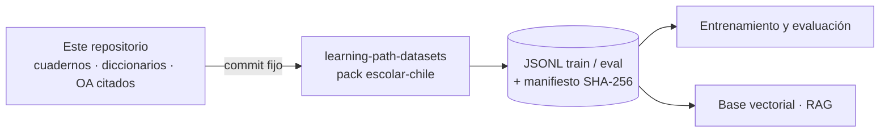

# Datasets, skills y agentes para entrenar con este currículo

Este proyecto es la **fuente** de contenido. Los datasets para entrenar modelos y la base vectorial viven en un repositorio aparte, [learning-path-datasets](https://github.com/vladimiracunadev-create/learning-path-datasets), para que el currículo no se mezcle con herramientas de datos ni sus pruebas (que ya tardan entre 25 y 40 minutos por publicación).

| Qué | Dónde |
|---|---|
| Currículo, cuadernos del estudiante y diccionarios (fuente) | este repositorio |
| Dataset JSONL de 1.º básico, con procedencia, licencia y evaluación | [learning-path-datasets](https://github.com/vladimiracunadev-create/learning-path-datasets) · [tarjeta del dataset](https://github.com/vladimiracunadev-create/learning-path-datasets/blob/main/docs/DATASET_CARD_escolar-chile.md) |
| Base vectorial local (NumPy exacto o Qdrant) | el mismo repositorio de datasets |
| Skills y agentes para crear datasets de conocimiento | `.claude/skills/` y `.claude/agents/` de este repositorio y del de datasets |

## Cómo se conectan

El exportador lee un **commit fijo** de este repositorio, de modo que el mismo commit produce el mismo dataset, byte a byte. Cada registro guarda el commit y la ruta de origen. Los textos oficiales de los objetivos de aprendizaje **no se copian**: solo se cita su código.

## Skills y agentes incluidos

Son generales (no dependen del dominio) y siguen un [estándar de conocimiento puro](https://github.com/vladimiracunadev-create/learning-path-datasets/blob/main/docs/KNOWLEDGE_STANDARD.md): registros atómicos, autocontenidos, fundamentados en la fuente y con licencia.

| Skill | Para qué sirve |
|---|---|
| `dataset-conocimiento-extraer` | convierte una unidad de cualquier fuente en registros de conocimiento con procedencia |
| `dataset-verificar` | verificación independiente: fidelidad a la fuente, corrección, duplicados, fuga, sesgos, derechos |
| `dataset-construir-publicar` | exportar, validar, comprobar reproducibilidad, actualizar cifras e indexar |
| `dataset-pack-nuevo` | sumar un programa o dominio nuevo al repositorio de datasets |

| Agente | Rol |
|---|---|
| `extractor-conocimiento` | autor: una unidad por vez |
| `verificador-independiente` | lector: contexto distinto al del autor |
| `curador-datasets` | orquesta el ciclo, máximo dos tareas en paralelo |
| `auditor-derechos-datos` | licencias, texto de terceros, datos personales y contenido que exige un experto |

La regla central es la misma que usa este proyecto para sus cuadernos: **quien verifica no es quien escribió**, y ninguno de los dos declara revisión humana.

## Cómo usarlos aquí

Las skills y los agentes están en `.claude/`, así que Claude Code los detecta al abrir este repositorio. Ejemplos de pedidos:

- «Usa `extractor-conocimiento` para extraer el conocimiento de la clase 1 de `MA01 OA 01`.»
- «Pasa esos registros por `verificador-independiente`.»
- «Con `curador-datasets`, exporta el siguiente nivel al repositorio de datasets.»

Para tenerlos en todos tus proyectos, el repositorio de datasets incluye un instalador: `python scripts/install_claude_assets.py` (no sobrescribe copias distintas sin `--force`).

## Límites

- Hoy el dataset publicado cubre **solo 1.º básico**; los otros once niveles están planificados.
- Todo el contenido fue elaborado con asistencia de IA y **no tiene revisión humana profesional**; los registros lo declaran así.
- Los datos escolares son **CC BY-NC-SA 4.0**: prohíben el uso comercial sin autorización del titular. Léase la [licencia de los datos](https://github.com/vladimiracunadev-create/learning-path-datasets/blob/main/DATA-LICENSE.md) antes de entrenar o redistribuir.
- La búsqueda vectorial por defecto es **léxica**, no semántica.
- Las skills y los agentes se probaron en su estructura y sus enlaces, no en la calidad de lo que producen en un dominio concreto.
